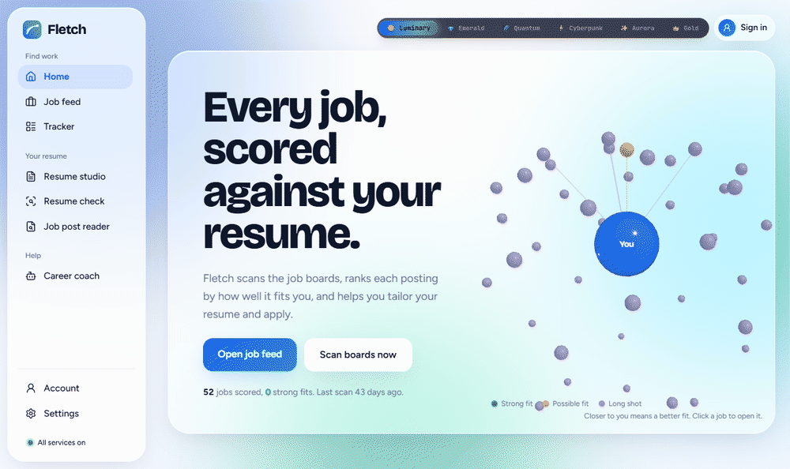
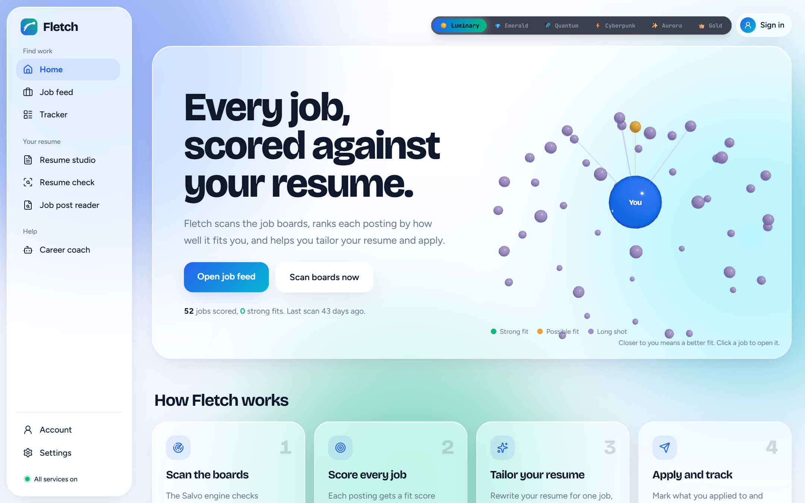
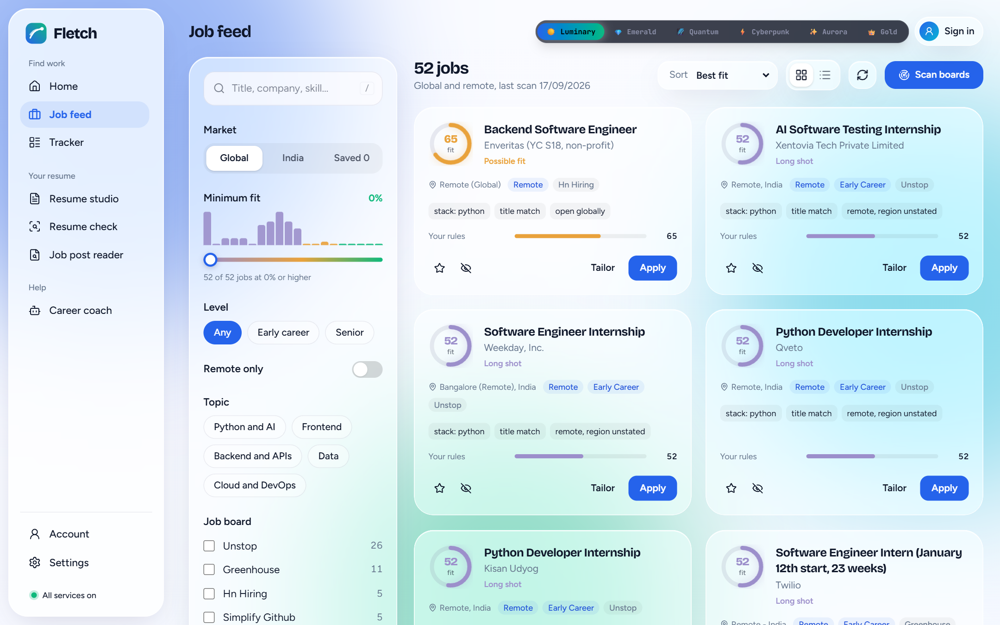
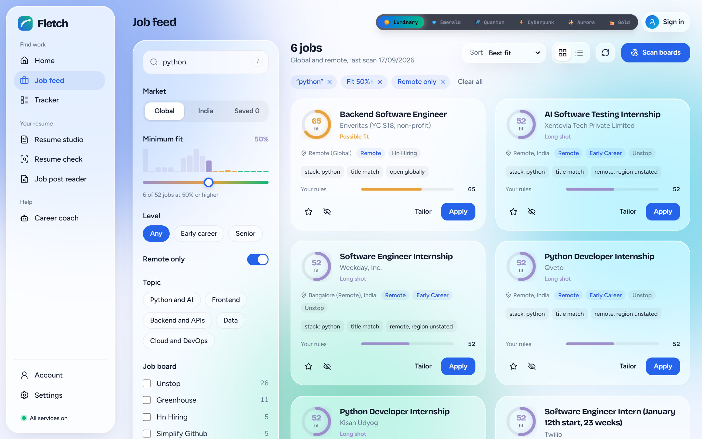
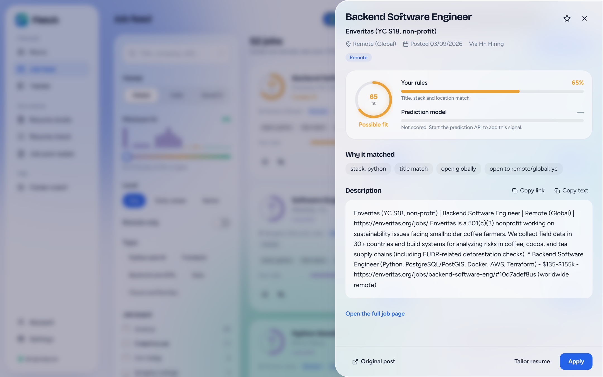
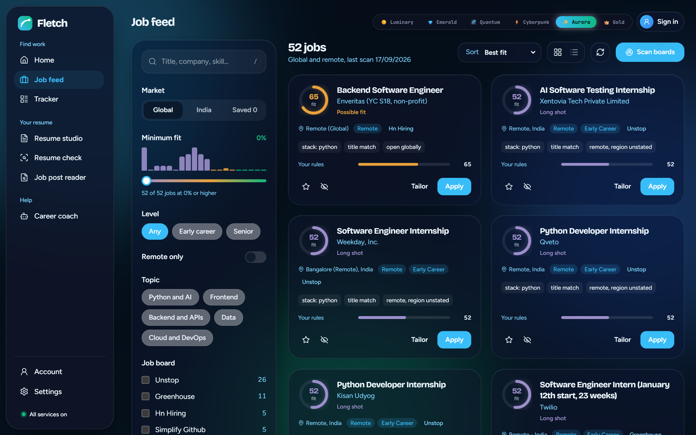
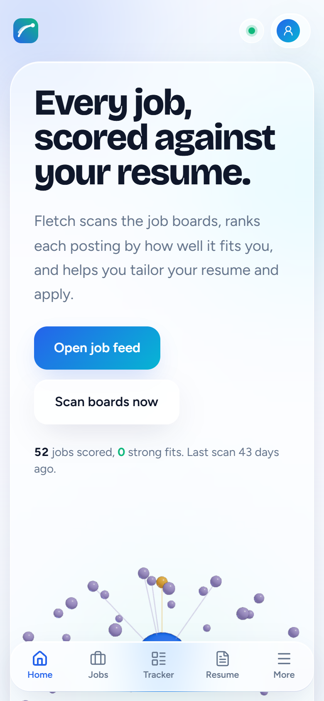
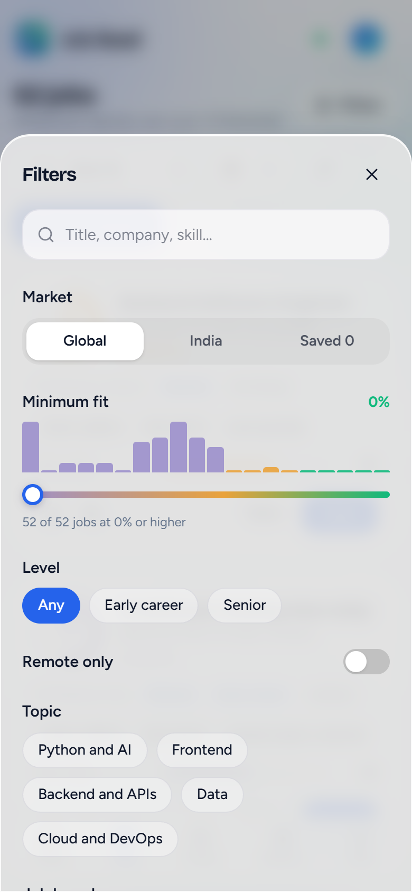
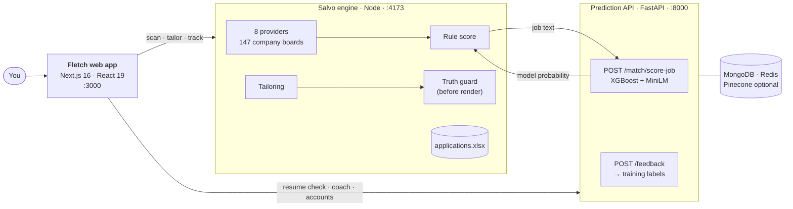

<div align="center">

# 🏹 Fletch

**Every job scored against your resume. Every application made for its target.**

Fletch scans public job boards, ranks each posting by how well it fits you, and writes a resume
tailored to that one job, using only facts from your own master resume.

[](https://github.com/ArpitThakur7/Job-Prediction/actions/workflows/ci.yml)
[](https://github.com/ArpitThakur7/Job-Prediction/actions/workflows/codeql.yml)
[](LICENSE)
[](https://arpitthakur7.github.io/Job-Prediction/)

[Live demo](https://arpitthakur7.github.io/Job-Prediction/) · [Screenshots](#screenshots) · [Quickstart](#quickstart) · [How it works](#how-it-works) · [Prediction model](#the-prediction-model) · [Security](SECURITY.md)

<sub>Formerly <em>Job Prediction</em>. <strong>Fletch</strong> is the app; <strong>Salvo</strong> is its engine that scans job boards.</sub>



</div>

## What it does

- **Finds jobs without logins.** The Salvo engine reads public listings from Greenhouse, Lever, Ashby,
  RemoteOK, Remotive, Unstop, Hacker News "Who's hiring" and SimplifyJobs, across 147 configured company boards.
- **Scores every posting two ways.** Your own rules (title, stack, location) and a trained XGBoost model
  that compares the job text with your resume. You choose how they're blended.
- **Tailors a resume per job, without inventing anything.** An LLM rewrites your resume for one posting.
  A truth guard then removes any employer, project, skill or number that isn't in your master resume or
  project bank, *before* the PDF is made. The cover letter gets the same check.
- **Helps you apply, never applies for you.** It can open an application form and pre-fill your details,
  but it never clicks Submit.
- **Tracks everything in one spreadsheet.** `applications.xlsx` holds statuses and notes; new scans merge in
  without overwriting what you wrote.
- **Learns from you.** Saving, hiding ("Not for me") and applying are recorded as training examples for the
  next model retrain.
- **Keeps your data on your machine.** Everything runs locally. The engine only answers your own frontend.

## Screenshots



| Job feed | Filters with fit distribution |
|---|---|
|  |  |
| **Job preview: why it matched and both scores** | **Dark theme (one of six)** |
|  |  |

<p align="center">
  
  &nbsp;&nbsp;
  
</p>

<sub>Regenerate these with the stack running: <code>node engine/capture_screenshots.mjs</code></sub>

## Quickstart

You need **Python 3.11+**, **Node.js 18+** and **MongoDB** (local or Atlas).

```bash
git clone https://github.com/ArpitThakur7/Job-Prediction.git fletch
cd fletch

# 1. Your settings and facts (all git-ignored)
cp .env.example .env                                         # add an LLM key (Groq, Gemini, OpenAI or Anthropic)
cp engine/config/profile.example.yaml engine/config/profile.yaml       # target titles, locations
cp engine/config/portfolio.example.yaml engine/config/portfolio.yaml   # your project bank
cp data/resume/resume.example.md data/resume/resume.md                 # your master resume
mkdir -p engine/data/resume && cp data/resume/resume.md engine/data/resume/resume.md

# 2. Install
python -m venv venv && source venv/bin/activate   # Windows: venv\Scripts\activate
pip install -r requirements.txt
npm --prefix engine install
npm --prefix frontend install
```

> [!IMPORTANT]
> **Replace the example resume with your own.** Scoring and tailoring read `data/resume/resume.md`
> (prediction API) and `engine/data/resume/resume.md` (Salvo engine); keep the two identical.

Then start the three parts. On Windows, `run.bat` does all of this, and `stop.bat` stops it.

```bash
uvicorn backend.main:app --port 8000      # prediction API   → http://127.0.0.1:8000/docs
npm --prefix engine start                 # Salvo engine     → http://127.0.0.1:4173
npm --prefix frontend run dev             # Fletch           → http://localhost:3000
```

Open the app, press **Scan boards**, and your feed fills with scored jobs.

**Docker:** `docker compose up --build` starts the API, frontend, MongoDB, Redis, Kafka and Spark.
Personal files in `data/` are excluded from the image.

## How it works



| Folder | What's in it |
|---|---|
| `frontend/` | The web app: job feed, filters, 3D home, resume studio, tracker |
| `engine/` | Salvo: board providers, scoring, tailoring, truth guard, tracker |
| `backend/` | Prediction API: matching, resume parsing, ATS scoring, auth, feedback |
| `ml/` | Feature engineering, training, model registry, retraining from feedback |
| `scripts/` | Dataset preparation and database seeding |
| `tests/` | Python tests (`tests/unit`, `tests/integration`) and engine tests (`tests/salvo`) |
| `docs/` | Architecture, decisions, how to add a job board, archived history |

Adding a job board is the easiest first contribution. See [docs/ADDING_A_PROVIDER.md](docs/ADDING_A_PROVIDER.md).

## The prediction model

An XGBoost classifier scores each resume–job pair on 15 features: skill overlap (whole-word matching
with aliases), semantic similarity (MiniLM embeddings), experience fit, education, location, and
early-career signals such as projects, internships and certifications. Models are versioned in
`ml/model/registry.json`, so a new model can be compared with the current one and rolled back.

> [!NOTE]
> **Read the numbers honestly.** There is no public dataset of real hiring outcomes, so training labels are
> generated by a scoring formula over ~120,000 resume–job pairs. The metrics below show how well the model
> learns that formula, not how often you'd get hired.

| Model | Skill matching | Similarity | AUC | F1 | Precision@10 |
|---|---|---|---|---|---|
| v1 | substring | TF-IDF | 0.874 | 0.829 | 0.697 |
| v2 | whole-word | MiniLM | 0.890 | 0.792 | 0.539 |

v2 fixes a bug where short skills like "R" and "Go" matched inside other words in every posting. That also
changes its labels, so the two rows are graded on different answer keys. The real test is your own
feedback: every save, hide and application in the feed becomes a labelled example, and
`python ml/retrain_with_feedback.py` retrains on them and promotes a new model only if it ranks your jobs better.

## Roadmap

- [x] Glass redesign of the home page and job feed, with fit filters
- [x] Truth guard before rendering, covering the summary, skills and cover letter
- [x] Real model scores in the job feed, plus learning from your saves, hides and applications
- [x] Security baseline: local-only engine, rate-limited auth, secret scanning, CodeQL
- [ ] Tailoring v2: map each job requirement to evidence in your resume and review changes bullet by bullet
- [ ] Run the AI locally (Ollama) so your resume never leaves your machine
- [ ] Demo mode with sample data, no API keys needed
- [ ] New design for the tracker, resume studio and resume check

Ideas and bug reports are welcome in [issues](https://github.com/ArpitThakur7/Job-Prediction/issues).

## Development

```bash
pytest tests                          # Python: API, ML pipeline, security
node --test tests/salvo/*.mjs         # engine: scoring, truth guard, request guard, API
cd frontend && npx tsc --noEmit && cd ..   # frontend type check
pre-commit install                    # ruff, mypy, gitleaks secret scanning on every commit
```

CI runs all of the above plus CodeQL, `pip-audit`, `npm audit` and gitleaks. Read
[CONTRIBUTING.md](CONTRIBUTING.md) before opening a pull request, and [SECURITY.md](SECURITY.md) to report a
vulnerability privately.

## License

MIT. See [LICENSE](LICENSE).

<div align="center"><sub>Built by <strong>Arpit Thakur</strong></sub></div>
