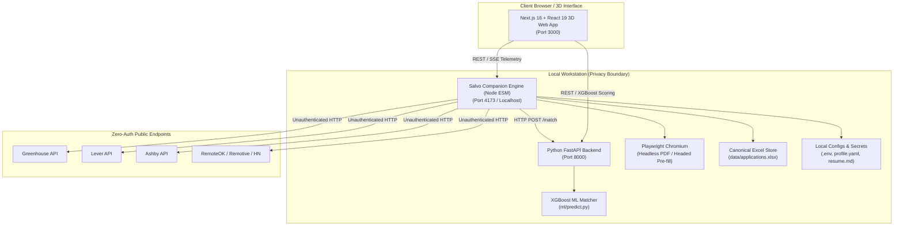
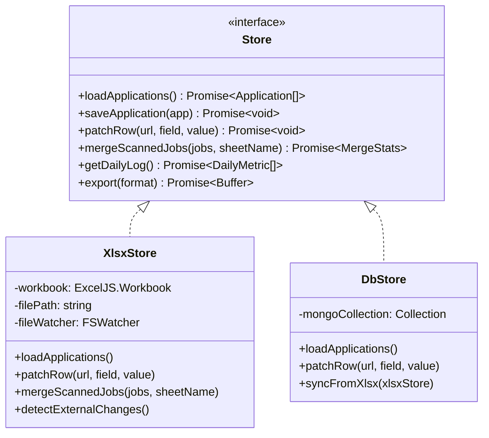
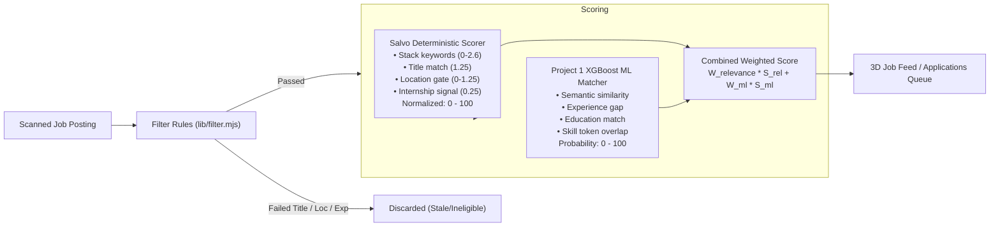
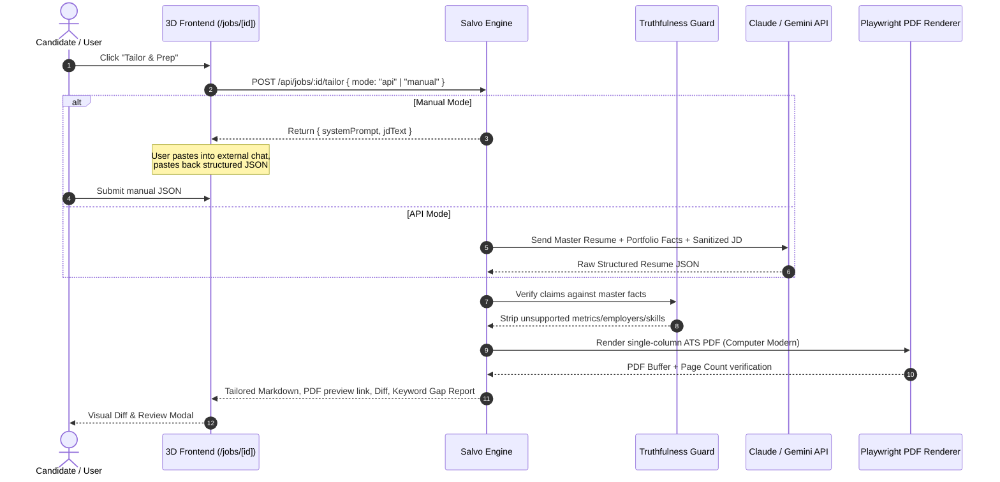
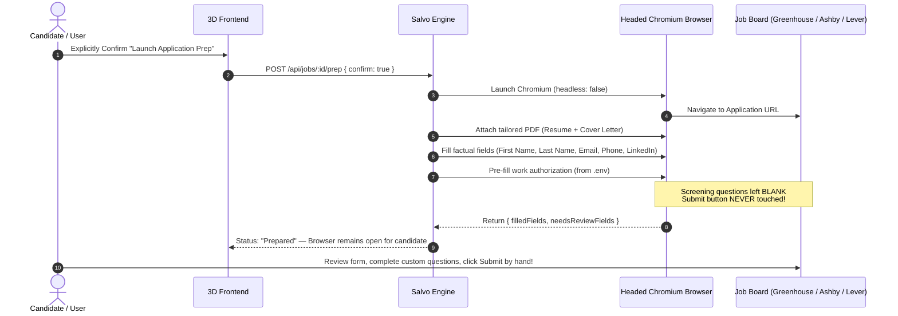

# 🧭 Salvo Integration Plan: Agentic Job Applier & 3D Job Prediction Platform

This document outlines the architectural plan for integrating **Salvo** (Zero-Auth Job Discovery, Fit-Scoring, Truth-Bounded Resume Tailoring & Form Pre-filler from `C:\Users\admin\Desktop\AUTO_JOB`) into **Project 1** (Next.js 16 + React 19 + Three.js 3D WebGL + FastAPI + XGBoost ML Platform).

---

## 1. System Overview & Component Analysis

### 1.1 Project 1 (The Host: 3D Job Prediction Platform)
- **Frontend**: Next.js 16.2.10 (App Router), React 19, TypeScript 5, Tailwind CSS v4.
- **3D & Visual Layer**: Three.js, `@react-three/fiber`, `@react-three/drei`, `framer-motion`, Lucide icons, 6 dynamic themes (`luminary`, `emerald`, `cyberpunk`, `quantum`, `gold`, `aurora`), 3D card tilt physics, holographic particle globe, skill matrix prisms.
- **Backend**: Python 3.13 / FastAPI 0.115 on port 8000 (`backend/main.py`), MongoDB 7.0 (MERN), Redis 7.0, Pinecone Vector DB, Apache Kafka, Apache Spark.
- **Machine Learning**: Supervised XGBoost classifier (`ml/model/xgb_matcher.pkl`) evaluating 9 pair features (`skill_overlap_count`, `skill_overlap_ratio`, `experience_gap`, `education_score`, `location_match`, `category_match`, `title_relevance`, `semantic_similarity`, `skills_count_resume`), yielding calibrated `match_probability` and SHAP explanations.

### 1.2 Project 2 (Salvo: Agentic Discovery & Human-in-the-Loop Applier)
- Sourced directly from `C:\Users\admin\Desktop\AUTO_JOB`.
- **Runtime**: Node.js ESM (`"type": "module"`, Node >= 18).
- **Zero-Auth Discovery Providers**: Greenhouse, Lever, Ashby, RemoteOK, Remotive, Hacker News "Who is Hiring", Unstop (public API only), Simplify-GitHub. All adhere to `{ id, detect, fetch }`.
- **Deterministic Filtering & Scoring**: `lib/filter.mjs` executing rule-based triage against `config/profile.yaml` (title matching, negative guards, location/remote gates, primary/secondary stack weights). Zero LLM calls for triage.
- **Truth-Bounded Resume Tailoring**: `modes/tailor-resume.md`, `lib/resume-render.mjs`. Strictly bounded to `resume.md` + verified facts in `portfolio.yaml`. Produces ATS-parseable single-column PDF rendered with Playwright Chromium.
- **Assisted Apply (Golden Rule)**: `prep-applications.mjs` and `lib/ats/` (`greenhouse.mjs`, `ashby.mjs`, `lever.mjs`, `generic.mjs`). Opens visible Playwright browser, fills factual fields (contact, links, attaches tailored PDF), and halts. **NEVER clicks Submit**.
- **Data & Tracking**: ExcelJS spreadsheet `data/applications.xlsx` is canonical. Preserves user-owned fields (`status`, `appliedOn`, `notes`) across re-scans.

---

## 2. Runtime Model & Language Boundary

### 2.1 The Challenge
1. **Local-First & Privacy Philosophy**: Secrets, API keys, resume text, and Excel records must remain on the user's local workstation.
2. **Playwright Execution Environment**: Playwright headed browser pre-filling and PDF rendering require a genuine operating system with Chromium binaries, desktop UI access, and local file I/O. They cannot execute inside serverless cloud hostings (e.g. Vercel / Netlify edge).
3. **Language Boundary**: Salvo is pure Node ESM; the host backend is Python FastAPI; the host frontend is Next.js 16 (Node runtime).

### 2.2 Selected Architecture: Companion Node Engine (`engine/`)
We establish a dedicated Node.js ESM companion engine (`engine/`) running locally on port `4173` (or customizable via `SALVO_PORT`):



### 2.3 Local-First vs Deployed Mode Capabilities

| Capability | Local Mode (`npm run dev` + `npm run engine`) | Deployed Preview (Vercel/Netlify) |
|---|---|---|
| 3D UI & Visualization | Full 3D scenes, tilt cards, animations | Full 3D scenes, tilt cards, animations |
| Job Feed & Scoring | Live scan, dual scores (deterministic + ML) | Read-only demo feed or remote engine bridge |
| Resume Tailoring | Full API mode & Manual prompt generator | Manual mode prompt generator & preview |
| ATS PDF Generation | Local Playwright Chromium rendering | Pre-rendered downloads or manual export |
| Assisted Form Pre-filler | Visible headed Playwright automation | Disabled (requires local desktop execution) |
| Excel Tracking | Reads/writes local `data/applications.xlsx` | Export CSV / Excel download |
| Privacy Guarantee | 100% data remains on user's machine | No personal credentials stored on cloud |

---

## 3. Storage Layer & The Store Interface

To honor Salvo's single-source-of-truth philosophy while enabling future flexibility, data access is abstracted behind a clean `Store` interface:



### Non-Destructive Re-Scan Merge Rules
- **Canonical user-owned columns**: `status`, `appliedOn`, `notes`.
- When a scan is executed:
  - If a job URL is new: inserted with status `discovered`, first seen date, calculated scores, and company metadata.
  - If a job URL already exists: metadata, posted date, and scores are refreshed; **user status, applied date, and notes are strictly preserved**.
  - Formula injection defense: any text input beginning with `=`, `+`, `-`, or `@` is sanitized before cell persistence.
  - EBUSY handling: If `applications.xlsx` is open in Microsoft Excel, return a clean `409 Conflict` prompt asking user to close Excel without crashing.

---

## 4. Dual-Signal Scoring Architecture

Salvo's deterministic scoring and Project 1's XGBoost ML model work together as complementary signals:



- **Explainability**: Every job card displays the exact breakdown:
  - Deterministic badges: `stack: react, node`, `open globally`, `title match`.
  - ML match percentage with confidence tier (`Strong Match`, `Match`, `Moderate`).

---

## 5. Truth-Bounded Tailoring & Security Workflow



### Security & Privacy Defenses
1. **Prompt Injection Defense**: Untrusted job descriptions are wrapped inside explicit isolation boundaries (`<untrusted_job_description>...`) with strict system instructions forbidding tool execution or prompt overrides.
2. **Truthfulness Guard (`lib/truth-guard.mjs`)**: Every employer name, job title, date span, and numerical claim is validated against `config/portfolio.yaml` and `data/resume/resume.md`. Any hallucinated employer or metric is removed before PDF generation.
3. **No Credential Exposure**: `.env` and sensitive auth tokens are never passed to the client; all LLM invocations occur server-side.

---

## 6. Assisted Form Pre-filler & The Golden Rule



---

## 7. Folder Structure & Mapping

The project structure will be organized cleanly within the host repository without breaking existing directories:

```
JOB_PREDICTION/
├── .env.example                  # Combined environment template
├── docs/
│   ├── INTEGRATION_PLAN.md       # This plan
│   ├── DECISIONS.md              # Technical decisions log
│   ├── ARCHITECTURE.md           # System architecture overview
│   ├── ADDING_A_PROVIDER.md      # Template for new discovery providers
│   └── TAILORING_PROMPT.md       # System prompt specification
├── engine/                       # Ported Salvo core (Node ESM)
│   ├── server.mjs                # Local HTTP/REST & SSE Engine Server
│   ├── package.json              # Engine dependencies (ExcelJS, Playwright, etc.)
│   ├── config/
│   │   ├── boards.yaml           # 130+ company board registry
│   │   ├── profile.yaml          # Search preferences, target titles, scoring weights
│   │   ├── portfolio.yaml        # Verified facts, projects, metric accomplishments
│   │   └── scoring.yaml          # Combined scoring weights configuration
│   ├── providers/                # Zero-auth discovery modules
│   │   ├── _http.mjs             # Resilient HTTP client with retry & backoff
│   │   ├── _registry.mjs         # Auto-discovery loader
│   │   ├── greenhouse.mjs
│   │   ├── lever.mjs
│   │   ├── ashby.mjs
│   │   ├── remoteok.mjs
│   │   ├── remotive.mjs
│   │   ├── hn-hiring.mjs
│   │   ├── unstop.mjs
│   │   └── simplify-github.mjs
│   ├── lib/
│   │   ├── filter.mjs            # Deterministic filter & scoring
│   │   ├── truth-guard.mjs       # Factual validation guard
│   │   ├── resume-render.mjs     # Single-column ATS PDF generator (Playwright)
│   │   ├── sheet-columns.mjs     # Excel column schema & user-owned rules
│   │   ├── store/
│   │   │   ├── interface.mjs     # Store abstract contract
│   │   │   ├── xlsx-store.mjs    # ExcelJS implementation (Single source of truth)
│   │   │   └── db-store.mjs      # MongoDB synchronization adapter
│   │   └── ats/                  # Playwright form fillers (NEVER SUBMITS)
│   │       ├── _shared.mjs
│   │       ├── greenhouse.mjs
│   │       ├── ashby.mjs
│   │       ├── lever.mjs
│   │       └── generic.mjs
│   ├── modes/
│   │   └── tailor-resume.md      # Truth-bounded prompt template
│   └── scripts/                  # CLI operations
│       ├── scan.mjs
│       ├── scan-india.mjs
│       ├── verify-boards.mjs
│       ├── batch-tailor.mjs
│       └── prep-applications.mjs
├── data/                         # Data directory (gitignored user content)
│   ├── applications.xlsx         # Primary tracker spreadsheet
│   ├── resume/resume.md          # Master candidate resume
│   └── generated/                # Tailored resumes, PDFs, keyword reports
├── frontend/                     # Next.js 16 Host Frontend
│   └── src/
│       ├── app/
│       │   ├── jobs/             # 3D-styled real-time job feed
│       │   │   ├── page.tsx
│       │   │   └── [id]/page.tsx # Job detail, gap analysis, Tailor & Prep
│       │   ├── applications/     # Tracker (Kanban, Table, 3D Funnel)
│       │   │   └── page.tsx
│       │   ├── resume/           # Master resume & portfolio facts editor
│       │   │   └── page.tsx
│       │   └── settings/
│       │       └── salvo/        # Profile editor, boards health, model status
│       │           └── page.tsx
│       └── components/
│           ├── salvo/            # Salvo 3D UI cards, diff viewers, score orbs
│           └── 3d/               # Existing 3D components reused
├── backend/                      # Python FastAPI Backend (Port 8000)
│   └── routes/match.py           # Existing XGBoost match endpoint
└── tests/
    ├── salvo/                    # Ported and expanded engine tests
    │   ├── test_providers.mjs    # Provider contract and mock fetch tests
    │   ├── test_filter.mjs       # Deterministic scoring tests
    │   ├── test_xlsx_merge.mjs   # Non-destructive merge tests
    │   ├── test_truth_guard.mjs  # Hallucination prevention tests
    │   └── test_ats_safety.mjs   # Strict Golden Rule (no submit button click)
    └── unit/                     # Existing Python test suite
```

---

## 8. API Contract & Communication Specification

The Engine exposes a typed REST and Server-Sent Events (SSE) API on `http://127.0.0.1:4173`:

| Method | Endpoint | Description |
|---|---|---|
| `GET` | `/api/health` | Engine status, Playwright availability, Excel lock status |
| `POST` | `/api/scan` | Trigger board scan (`{ mode: "global" \| "india" }`), returns job ID |
| `GET` | `/api/scan/:id/stream` | SSE stream for real-time progress, scraped counts, and logs |
| `GET` | `/api/jobs` | Retrieve filtered and scored jobs with pagination & filters |
| `GET` | `/api/jobs/:id` | Detailed job posting with score reasons and gap report |
| `POST` | `/api/boards/verify` | Run verification on all ATS endpoints in `boards.yaml` |
| `GET` | `/api/providers/health` | Health metrics and response times for all discovery providers |
| `GET/PUT` | `/api/profile` | Read and update `config/profile.yaml` with schema validation |
| `GET/PUT` | `/api/resume` | Read and update master `resume.md` |
| `GET/PUT` | `/api/portfolio` | Read and update `portfolio.yaml` |
| `POST` | `/api/jobs/:id/tailor` | Generate tailored resume markdown, keyword gap report, ATS PDF |
| `POST` | `/api/jobs/:id/prep` | Launch Playwright to pre-fill application form (Never submits) |
| `GET` | `/api/applications` | Retrieve all tracked applications from `applications.xlsx` |
| `PATCH` | `/api/applications/:url` | Update user-owned fields (`status`, `notes`, `appliedOn`) |
| `GET` | `/api/applications/export` | Download spreadsheet as `.xlsx` or `.csv` |
| `GET` | `/api/files/download` | Download generated tailored resume PDF |

---

## 9. Phased Delivery Roadmap

### Phase 1: Engine Foundation & Discovery Core
- Scaffold `/engine` with Node ESM, dependencies, and TypeScript/ESM tooling.
- Port all discovery providers (`greenhouse`, `lever`, `ashby`, `remoteok`, `remotive`, `hn-hiring`, `unstop`, `simplify-github`) with shared resilient runner (`_http.mjs`).
- Port `boards.yaml` and `verify-boards.mjs`.
- Implement `Store` interface and `XlsxStore` with non-destructive merge logic.
- Add unit tests for providers and Excel merge integrity.

### Phase 2: Dual Scoring Engine & Profile Management
- Port `lib/filter.mjs` deterministic scoring (normalized to 0-100).
- Integrate Python XGBoost prediction signal bridge (`/match`) to produce the unified combined score.
- Implement profile and config management APIs (`/api/profile`, `/api/portfolio`).
- Unit tests for scoring weights, experience exclusions, and regional gates.

### Phase 3: Truth-Bounded Resume Tailoring
- Port `modes/tailor-resume.md` and `lib/resume-render.mjs` (Computer Modern ATS PDF).
- Implement post-generation truthfulness verification guard (`lib/truth-guard.mjs`).
- Implement API mode (Claude / Gemini with configurable models) and Manual mode (copy/paste prompt generator).
- Unit tests for hallucination blocking and prompt injection isolation.

### Phase 4: 3D Frontend Integration
- Build `/jobs` and `/jobs/[id]` pages inside the Next.js 16 app with 3D card tilt physics, animated score orbs, and live scan telemetry.
- Build `/resume` editor with markdown preview and portfolio fact management.
- Build `/settings/salvo` for profile configuration, board health diagnostics, and model status.
- Ensure full responsiveness, dark/light theme synchronization, and 2D fallback.

### Phase 5: Assisted Apply & Application Tracker
- Port Playwright ATS form pre-fillers (`greenhouse`, `ashby`, `lever`, `generic`).
- Enforce the Golden Rule with safety assertions: code must NEVER click Submit.
- Build `/applications` page in Next.js with 3D funnel visualization, interactive Kanban board, and data table.
- Implement external file watching for `applications.xlsx`.

### Phase 6: End-to-End Verification & Documentation
- Comprehensive test suite execution (Engine unit tests, Python backend tests, Next.js build).
- Complete documentation: `README.md` updates, `docs/ARCHITECTURE.md`, `docs/ADDING_A_PROVIDER.md`, `docs/TAILORING_PROMPT.md`.
- Security and privacy audit review.

---

## 10. Blocking Questions & Recommendations for Approval

1. **Companion Node Engine Process**:
   - *Recommendation*: Run the Salvo companion engine as a background local process on `http://127.0.0.1:4173` via a simple root command `npm run engine` (or unified `run.bat`). Next.js talks directly to this endpoint. This completely avoids Next.js/Turbopack native packaging issues with Playwright and Chromium.
2. **Deterministic Score Normalization**:
   - *Recommendation*: Scale Salvo's raw 0-5 fit score to 0-100, combine with XGBoost's 0-100 match probability using default weights (60% Salvo relevance + 40% XGBoost ML score), fully configurable in `config/profile.yaml`.
3. **Storage Priority**:
   - *Recommendation*: Use `data/applications.xlsx` as canonical storage, with optional background read-mirroring to MongoDB for existing analytics widgets.
